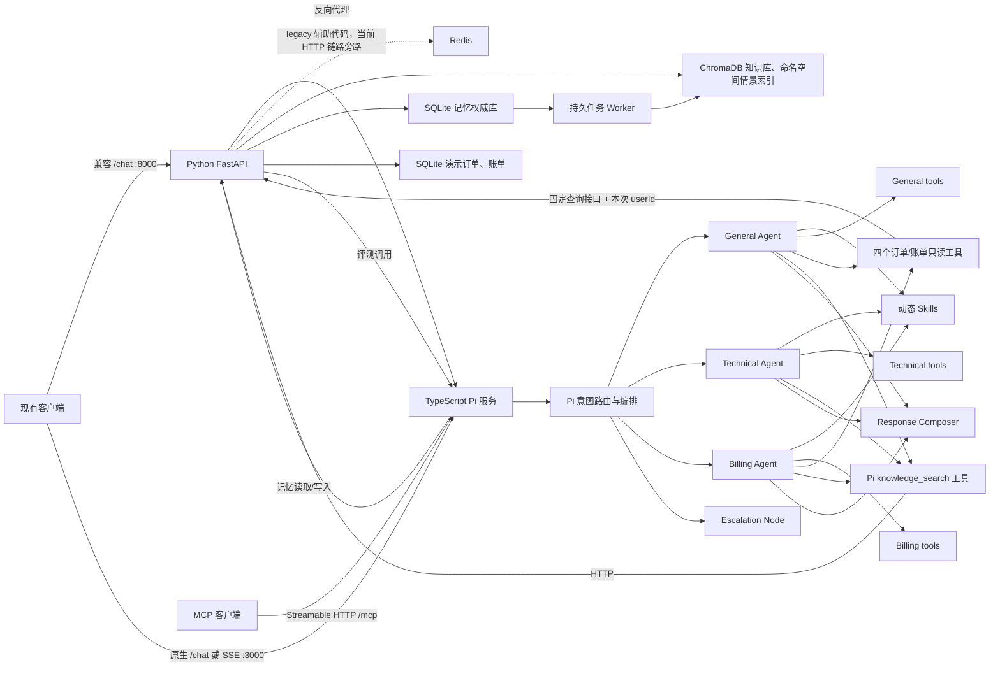

# LumenMind Pi

LumenMind 的 Agent 运行时基于 TypeScript + Pi Agent SDK，同时保留 Python 的记忆、知识库管理、评测和监控基础设施。

[MIT License](LICENSE) · [参与贡献](CONTRIBUTING.md) · [安全说明](SECURITY.md) · [开源状态与已知问题](docs/OPEN_SOURCE_STATUS.md)

> 开发预览：业务查询、路由和工具链已有实现；记忆升级的会话、摘要、事实、索引和离线迁移主链路已接通；完整部署及故障验收仍有待办。当前没有生产级认证，请在受信任的本地环境中运行。历史验收报告仅适用于其注明的日期和业务范围。

2026-10-19 已按模块实现数据库租约与幂等、后台恢复、完整轮次摘要、来源证据与事实纠正、遗忘屏障、角色化历史、模型预算、Chroma 索引 outbox 和备份优先的离线迁移。验证结果与限制见 [记忆开发验收记录](docs/AGENT_MEMORY_ACCEPTANCE.md)，迁移步骤见 [操作指南](docs/MEMORY_MIGRATION.md)。

当前实现包含 2026-09-28 的运行时更新：细粒度意图、结构化实体、主/辅助 Agent 路由、低置信度澄清、请求级工具轨迹、幂等知识库写入、RAG 工具自主调用，以及 Redis/ChromaDB 非阻塞异步访问。

当前使用官方新命名空间：

- `@earendil-works/pi-agent-core@0.82.1`
- `@earendil-works/pi-ai@0.82.1`
- `@modelcontextprotocol/sdk@1.30.0`

## 架构



核心边界是“替换 Agent 运行时，保留业务基础设施”：

- TypeScript：Pi Agent 生命周期、工具循环、结构化 Agent 契约、多实例性能路由、独立升级节点、多 Agent Composer、Skills、SSE、MCP。
- Python：SQLite 演示订单/账单只读查询、SQLite 记忆权威存储、持久摘要/事实任务与遗忘屏障、知识库与管理、LLM-as-Judge 评测、Prometheus、旧 API 兼容代理。新记忆链路直接从 SQLite 构建快照；Redis 版本化渲染缓存尚未启用。Chroma 情景索引使用可重试 outbox 和 SQLite 复核。

记忆模块的后续开发依据 [Agent 记忆优化开发方案](docs/AGENT_MEMORY_DEVELOPMENT.md)，包含现状问题、目标架构、接口协议、数据迁移、分阶段任务和验收标准。文档保留原始设计基线，并在第 18 节记录本次实现调整及尚未验收的项目。

当前记忆主库默认为 `data/memory/memory.sqlite3`（Compose 中为 `/app/data/memory/memory.sqlite3`）。新请求使用 `/memory/turn/begin` → `/memory/context` → `/memory/turn/finish`，旧 `/memory/turn` 仍可兼容调用。事实、设置和删除接口已接通；`anonymous`/`demo` 不抽取跨会话事实。明确事实 ID 可直接撤回，含糊的删除描述会要求澄清。物理删除的索引清理进度由 `GET /memory/cleanup` 查询；迟到写入未确认前保持 PENDING。

## 快速启动

要求 Docker 与 Docker Compose。Node 本地开发要求 `>=22.19.0`。

```bash
git clone https://github.com/Go-Go-Zeppelin/LumenMind-pi.git
cd LumenMind-pi
cp .env.example .env
# 编辑 .env，至少填写 ANTHROPIC_API_KEY
docker compose up --build
```

验证 Pi 原生入口：

```bash
curl -s http://localhost:3000/health
curl -s http://localhost:3000/chat \
  -H 'content-type: application/json' \
  -d '{"message":"登录报错 401，而且还被重复扣款","user_id":"demo"}'
```

验证原 FastAPI 兼容入口（请求会转发给 Pi，而不是旧 Python Agent）：

```bash
curl -s http://localhost:8000/chat \
  -H 'content-type: application/json' \
  -d '{"message":"退款多久能到账？","user_id":"demo"}'
```

接口文档位于 [http://localhost:8000/docs](http://localhost:8000/docs)。

## 最小订单与账单演示

Compose 启动时创建 `/app/data/business/business.sqlite3`，通过现有 `./data:/app/data` 挂载持久化。`BUSINESS_SEED_DEMO=true` 在事务中幂等导入固定演示数据；重复启动不会重复插入或覆盖已有行。本地默认路径为项目根目录 `data/business/business.sqlite3`，默认不导入；可以设置 `BUSINESS_DB_PATH` 和 `BUSINESS_SEED_DEMO=true`。数据库不应提交到版本管理。

现有前端默认使用 `u1001`，无需修改。数据均为演示业务记录，`paid` 和支付方式不能视为真实支付渠道扣款凭证。

| 用户 | 订单 / 账单 | 商品 | 金额 | 订单状态 | 账单状态 |
|---|---|---|---|---|---|
| u1001 | ORD-1001-001 / BILL-1001-001 | 无线键盘 | 129.00 元 | shipped | paid |
| u1001 | ORD-1001-002 / BILL-1001-002 | 鼠标 | 59.00 元 | pending_payment | unpaid |
| u1001 | ORD-1001-003 / BILL-1001-003 | USB-C 扩展坞 | 99.00 元 | completed | paid |
| u1002 | ORD-1002-001 / BILL-1002-001 | 机械键盘 | 199.00 元 | processing | paid |

只提供四个 GET 查询接口，所有接口必填 `user_id`。列表 `limit` 默认 10，范围 1～20，按创建时间和编号倒序；`count` 为本次返回条数。金额保留整数分。

```bash
docker compose config --quiet
docker compose up -d --build python-infra pi-agent
curl -fsS 'http://localhost:8000/business/orders?user_id=u1001'
curl -fsS 'http://localhost:8000/business/orders/ORD-1001-001?user_id=u1001'
curl -fsS 'http://localhost:8000/business/bills?user_id=u1001&order_id=ORD-1001-001'
curl -fsS 'http://localhost:8000/business/bills/BILL-1001-002?user_id=u1001'
curl -fsS http://localhost:8000/chat \
  -H 'content-type: application/json' \
  -d '{"user_id":"u1001","message":"订单 ORD-1001-001 发货了吗？"}'
# 用聊天返回的 request_id 查询证据
curl -fsS 'http://localhost:8000/trace/tool/替换为request_id'
```

可继续提问“查一下我的订单”“查看我的账单”“订单 ORD-1001-001 的账单”“查询账单 BILL-1001-002”。General 和 Billing 均提供 `list_orders`、`get_order`、`list_bills`、`get_bill`，即使关闭知识检索或降级到 General 也可查询；Technical 保持原工具范围。工具 schema 不含 `user_id`，每次 run 通过闭包绑定编排器标准化后的身份，复用 Agent 实例不会共享可变用户字段。成功查询记录进入 `tools_used`，全部调用及实际返回值进入 trace 的 `tool_calls`；业务查询不会将 `knowledge_used` 设为 true。

当前 `user_id` 仅是客户端选择的演示身份；SQL 的归属过滤不是登录鉴权。未知用户、`anonymous` 和 `demo` 不映射为 u1001，列表为空；详情不存在或属于其他用户统一返回 `404 not_found`。非法参数为 422，数据库连接/查询故障为 `503 business_unavailable`，不会伪装成空数据。只支持列表和详情，不支持翻页、物流轨迹、预计送达时间、下单、支付、退款、开票或后台录入。MCP 仍仅公开知识检索工具。

## 主要接口

| 服务 | 接口 | 说明 |
|---|---|---|
| Pi `:3000` | `POST /chat` | JSON 对话主入口 |
| Pi `:3000` | `POST /chat/stream` | Pi 事件流映射为 SSE |
| Pi `:3000` | `POST /intent` | 无副作用意图识别；默认仅规则，不读写记忆 |
| Pi `:3000` | `GET /trace/tool/{request_id}` | 查询单次请求的工具调用轨迹 |
| Pi `:3000` | `GET /trace/tools?limit=20` | 查询最近请求的工具调用轨迹 |
| Pi `:3000` | `GET /skills` / `POST /skills/reload` | Skills 状态与热加载 |
| Pi `:3000` | `POST /mcp` | 无状态 Streamable HTTP MCP |
| Python `:8000` | `POST /chat` | 兼容代理到 Pi |
| Python `:8000` | `GET /business/orders` / `/business/orders/{order_id}` | 当前演示用户的订单列表/详情 |
| Python `:8000` | `GET /business/bills` / `/business/bills/{bill_id}` | 当前演示用户的账单列表/详情；列表可按 order_id 过滤 |
| Python `:8000` | `POST /memory/turn/begin` / `renew` / `finish` | 租约、幂等、最终回复持久化；旧 `/memory/turn` 仅兼容 |
| Python `:8000` | `POST /memory/context` / `flush` | 一致快照与限时事实整理 |
| Python `:8000` | `GET /memory/facts`、`DELETE /memory/facts/{id}`、`POST /memory/clear` / `settings` | 事实来源、遗忘、清空与开关 |
| Python `:8000` | `GET /memory/status` / `cleanup` | 无正文队列统计及索引清理进度 |
| Python `:8000` | `POST /knowledge/search` | Pi/MCP 共用的 HTTP 检索接口 |
| Python `:8000` | `/knowledge/add`、`/upload`、`/stats` | 知识库管理 |
| Python `:8000` | `POST /eval/run` | 规则、Trace、会话目标、重复运行与离线发布检查 |
| Python `:8000` | `GET /monitor` / `GET /metrics` | 监控摘要与 Prometheus |

`knowledge_search` 是业务 Agent 共享的只读工具；是否调用由 Agent 根据问题和上下文决定，路由层不会预先检索或把结果拼进 prompt。`knowledge_used` 只有在 Pi Agent 实际调用 `knowledge_search` 且返回非降级结果时才为 `true`。

`POST /intent` 默认只执行确定性规则和实体提取，不调用 Python 记忆、业务 Agent 或知识库；传入 `use_llm: true` 才会在低置信度时允许 IntentRouter 调用模型。

意图识别采用规则 → Embedding 候选召回 → LLM 最终判断的混合链路：明确规则（置信度 >= 0.9）直接返回；规则未命中或低置信度时，Pi 通过 Python/ChromaDB 的 `/intent/embedding` 召回候选意图，再交给 LLM 判断。Embedding 索引可通过 `PI_EMBEDDING_INTENT`、`PI_EMBEDDING_INTENT_TOP_K` 和 `PI_EMBEDDING_INTENT_THRESHOLD` 配置；LLM 不可用时，仅当候选超过阈值才作为安全兜底。

每次 Pi `/chat` 响应都会返回 `request_id` 与 `tools_used`。可使用该 ID 查询最近的请求 trace；trace 默认仅保存在 Pi 进程内，最多保留 200 条，可通过 `PI_TOOL_TRACE_MAX` 调整，重启后清空。它用于排查和审计，不是持久化、可重放执行记录。专业 Agent 失败后发生的工具调用会在 trace 中保留，并标记 `fallback_used`。

Agent 池默认每类 1 个实例，可通过 `PI_GENERAL_REPLICAS`、`PI_TECHNICAL_REPLICAS`、`PI_BILLING_REPLICAS` 扩容。同类实例按成功率、延迟和 `monitor_penalty` 计算 `routing_score`，选择当前最优实例；同类实例全部达到 `PI_MONITOR_FALLBACK_PENALTY`（默认 `0.5`）时，本次请求从该专业类型回退到 General；`PI_TOOL_TRACE_MAX` 控制 trace 保留数量。

每个业务 Agent 还有实际的角色专属工具白名单：General（请求上下文/必要字段）、Technical（错误码/排障计划）、Billing（账单字段/金额比较）。多 Agent 结果会经过 Response Composer 汇总；紧急和转人工意图直接进入独立的非 LLM Escalation 节点。

只做无副作用的意图评测时，显式传空的 `dialog_cases` 并关闭评测计数：

```bash
curl -s http://localhost:8000/eval/run \
  -H 'content-type: application/json' \
  -d '{
    "intent_cases": [
      {"message":"退款多久到账？", "expected_intent":"refund"},
      {"message":"登录一直报401", "expected_intent":"technical_login"}
    ],
    "dialog_cases": [],
    "record_metrics": false
  }'
```

这条路径不会调用 Pi `/chat`，不会写 Redis、更新画像、检索 ChromaDB，也不会增加 Pi Agent 运行统计。对话质量评测仍然必须调用 `/chat` 和 LLM-as-Judge，因此应当在独立的评测数据/基础设施上运行。

对话评测可以提供期望意图和业务验收规则，用于检查“意图正确性 × 答案质量”以及安全规则硬失败：

```json
{
  "intent_cases": [],
  "dialog_cases": [
    {
      "question": "退款多久到账？",
      "expected_intent": "refund",
      "required_points": ["需要核验", "支付渠道"],
      "forbidden_patterns": ["立即到账", "支付密码"]
    }
  ]
}
```

`expected_intents` 可按多轮对话逐轮标注。响应中的 `quality_analysis` 会返回四象限计数和比例、按 Agent/意图分组、“意图错但答案好”专项统计，以及业务规则违规的规则名和样例。答案分数达到阈值但命中业务规则时，仍会保留在质量象限中，同时将该条评测标记为硬失败。

评测已扩展为规则优先的离线质量闭环，支持 `repeats`、`judge_mode`、工具与 Skill 验收、会话目标、稳定性统计、结构化错例和可比基线门禁。核心候选集包含 20 条意图样本与 30 个对话场景，尚待业务复核。

```bash
cd python-service
# 只检查用例契约，无模型和业务副作用
.venv/bin/python -m evaluation.run_suite --dry-run
# 在独立评测环境运行，模型裁判与被测 Agent 都可能消耗模型额度
.venv/bin/python -m evaluation.run_suite --repeats 3
```

详细输入、报告与门禁边界见 [Agent 评测闭环](docs/EVALUATION.md)。`persist_report=true` 会保存执行轨迹快照与错例问题簇；正常运行不会覆盖历史基线。`release_gate=review` 表示仍需人工确认或补充证据，不能直接用于无人值守发布。

`/chat` 继续兼容原字段，并新增：

- `intent_group`：细粒度意图所属的大类，例如 `refund -> billing`。
- `agent_types`、`primary_agent`、`supporting_agents`：实际执行 Agent 与结构化主辅路由。
- `routing_reason`、`routing_confidence`：可解释路由依据与置信度。
- `entities`：规则提取的订单号、日期、金额和错误码。
- `intent_confidence`、`intent_source_scores`：意图置信度及 Pi LLM/规则来源分数。

当前细粒度意图包括 `order_status`、`logistics`、`refund`、`invoice`、`payment_issue`、`account_security`、`technical_login`、`technical_crash` 和 `human_handoff`。普通 Agent 的知识工具独立于业务查询工具；转人工和低置信度 `other` 的澄清路径不执行业务 Agent。

## MCP 使用

Streamable HTTP MCP 地址：

```text
http://localhost:3000/mcp
```

它公开只读工具 `knowledge_search(query, top_k)`。也可运行 stdio 版本：

```bash
cd agent-service
PYTHON_INFRA_URL=http://localhost:8000 npm run mcp:stdio
```

## 本地开发与验证

```bash
cd agent-service
npm install
npm run typecheck
npm test
npm run build

cd ../
python3 -m compileall -q python-service
cd python-service
.venv/bin/python -m pytest tests -q
cd ..
docker compose config --quiet
```

测试覆盖细粒度意图、实体抽取、主辅路由、复合问题协作、按意图启用 RAG、Skills 匹配、Pi HTTP 工具，以及真实 MCP initialize/listTools/callTool 协议链路。

业务 API 测试使用临时 SQLite 和独立 FastAPI app，不启动 Redis/Chroma、不写正式库。TypeScript 业务工具/执行器测试 mock HTTP 和模型事件，覆盖用户隔离、异常 trace、正常路径、专业 Agent 失败降级和监控降级；真实模型聊天单独进行 Docker 验收。

2026-10-08 实际验收：TypeScript 56 项测试、Python 51 项测试、类型检查与构建通过；Docker 15 项直接 HTTP 检查和 11 次真实模型聊天通过，包含 Pi 原生 `/chat`、`/chat/stream`、用户隔离和工具 trace。重启 Python 后记录及数据库 SHA256 不变。详见 [验收记录](docs/MINIMAL_BUSINESS_ACCEPTANCE.md) 和 [完整响应与 trace 快照](docs/MINIMAL_BUSINESS_ACCEPTANCE.json)。

## Anthropic-compatible 模型

可继续复用现有配置，例如兼容 Anthropic Messages API 的模型服务：

```dotenv
ANTHROPIC_API_KEY=...
ANTHROPIC_MODEL=your-model-id
ANTHROPIC_BASE_URL=https://example.com/anthropic
```

也可通过 `PI_API_KEY`、`PI_MODEL`、`PI_BASE_URL` 仅覆盖 TypeScript Agent 服务。Pi 会使用当前配置动态克隆模型元数据，并保留工具调用能力。

## 是否完全替换 FastAPI

当前不建议删除 FastAPI。先用 `/eval/run`、线上成功率、延迟和人工抽检比较新旧效果；确认 Redis/Chroma 管理、文件上传、评测与运维链路都有 TypeScript 替代方案后，再决定第二阶段迁移。详细映射见 [MIGRATION.md](./MIGRATION.md)。
